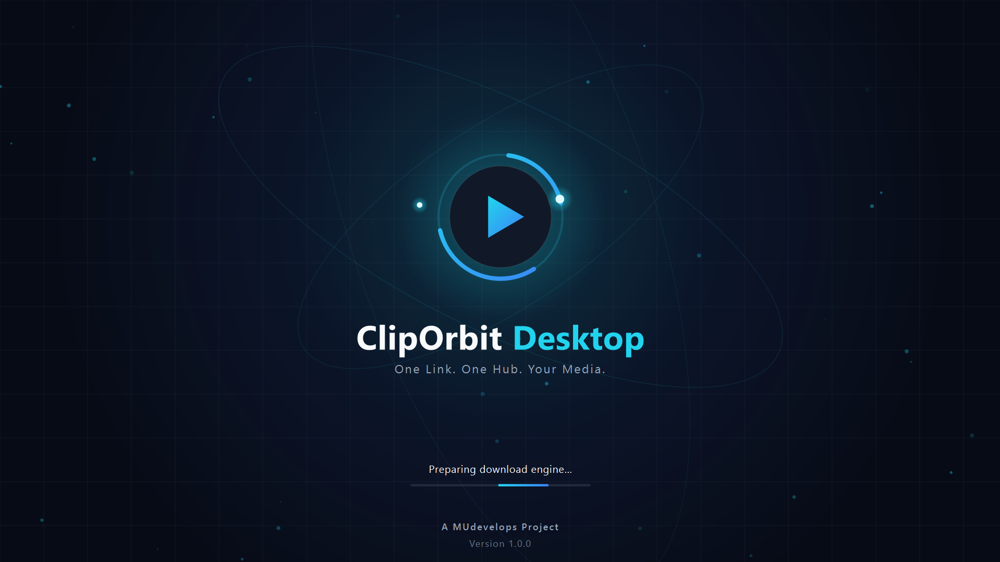
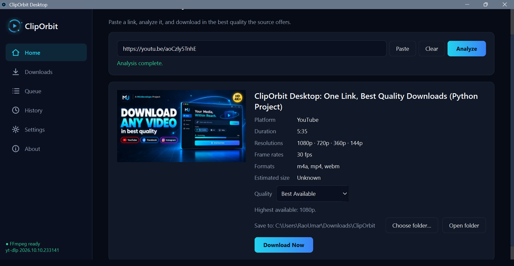
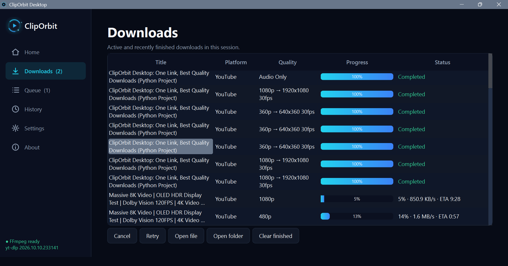
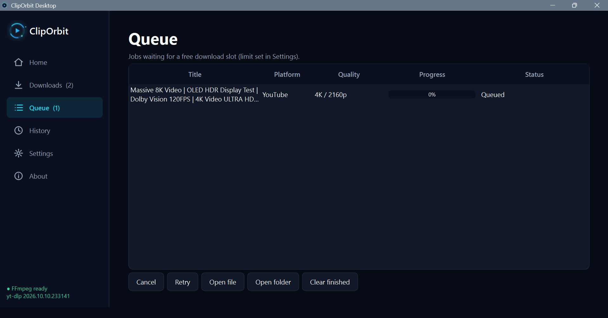
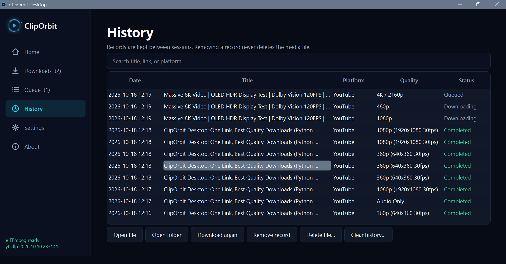
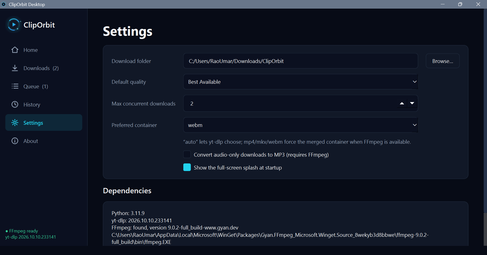
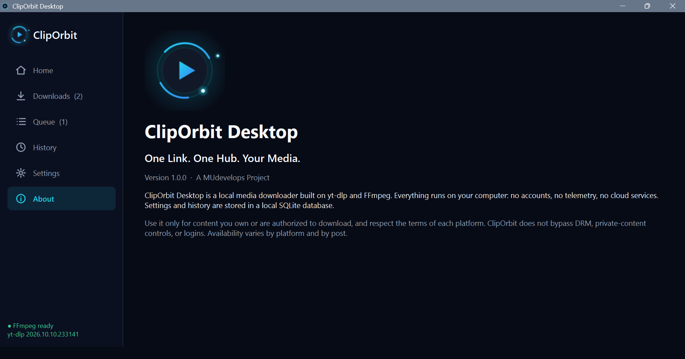
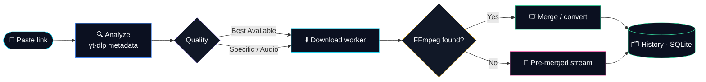

<div align="center">



<br>


**A premium dark-themed media downloader for Windows.**
Paste a link, analyze it, and download in the best quality the source actually offers.

[▶ **Watch the demo**](https://youtu.be/aoCzly5TnhE) &nbsp;·&nbsp; [⬇ **Quick start**](#-quick-start) &nbsp;·&nbsp; [🐞 **Report a bug**](https://github.com/MUdevelops/ClipOrbit-Desktop/issues)



</div>

<br>


<div align="center">

<a href="https://youtu.be/aoCzly5TnhE">
  
</a>

**[▶ Click to watch the full walkthrough on YouTube](https://youtu.be/aoCzly5TnhE)**

</div>


<div align="center">

### 🌌 Splash Screen
*Full-screen, animated, and driven by real startup steps. No fake progress bars.*



</div>

<table>
<tr>
<td width="50%" valign="top">

### 🏠 Dashboard
Paste, analyze, choose quality, download.



</td>
<td width="50%" valign="top">

### ⬇️ Downloads
Live progress, speed, ETA, cancel and retry.



</td>
</tr>
<tr>
<td width="50%" valign="top">

### 🕒 Queue
Jobs wait here until a download slot is free.



</td>
<td width="50%" valign="top">

### 📚 History
Searchable, and it survives restarts.



</td>
</tr>
<tr>
<td width="50%" valign="top">

### ⚙️ Settings
Folder, quality, concurrency, container, MP3, dependency status.



</td>
<td width="50%" valign="top">

### ℹ️ About
Version, credits and usage notice.



</td>
</tr>
</table>


<table>
<tr>
<td width="33%" valign="top">

#### 🎯 One-link workflow
Paste → Analyze → **Download Now**.

</td>
<td width="33%" valign="top">

#### 🏆 Best Available by default
Uses yt-dlp format selection (`bv*+ba/b`) with **no resolution cap**: 1080p, 1440p, 4K, 8K and beyond when the source has it.

</td>
<td width="33%" valign="top">

#### ✅ Honest quality list
Only resolutions detected for the media are enabled. Nothing is faked or silently downgraded.

</td>
</tr>
<tr>
<td valign="top">

#### 🖼 Metadata preview
Thumbnail, title, platform, duration, resolutions, frame rates, formats, estimated size.

</td>
<td valign="top">

#### 🎧 Audio only
Best audio stream, with optional **MP3 conversion** (needs FFmpeg).

</td>
<td valign="top">

#### 🧵 Background workers
Analysis and downloads never freeze the interface.

</td>
</tr>
<tr>
<td valign="top">

#### 🚦 Queue & concurrency
Multiple jobs with a limit of 1-5. Cancelling one never touches another.

</td>
<td valign="top">

#### 🔁 Retry & resume
Progress, speed, ETA, cancel, retry and partial-download resume.

</td>
<td valign="top">

#### 🗂 Safe history
SQLite-backed and searchable. Removing a record **never** deletes your file.

</td>
</tr>
<tr>
<td valign="top">

#### 🎬 Cinematic splash
Resolution-aware full-screen splash that fades into the app.

</td>
<td valign="top">

#### 🔒 Private by design
No accounts, telemetry or cloud. Everything runs locally.

</td>
<td valign="top">

#### 📦 Single-file source
The whole application lives in `main.py`.

</td>
</tr>
</table>

### How it works




ClipOrbit uses yt-dlp's extractors, so support follows yt-dlp.

| Platform | Status |
|:--|:--|
| ▶️ **YouTube / Shorts** | ✅ Works in my tests |
| 📘 **Facebook** | ✅ Works in my tests |
| 📸 **Instagram** | ✅ Works in my tests |
| 🎵 **TikTok** | ⚠️ Depends on yt-dlp; may fail when TikTok changes |
| 🌐 **X / Twitter, Snapchat Spotlight, others** | Supported by yt-dlp where available; not individually verified |

> [!NOTE]
> Platforms change often. Keep yt-dlp updated (see [Troubleshooting](#-troubleshooting)).


**Requirements:** Windows 10/11 · **Python 3.11.9** · `PySide6` and `yt-dlp` (in `requirements.txt`) · **FFmpeg** recommended

```bash
git clone https://github.com/MUdevelops/ClipOrbit-Desktop.git
cd ClipOrbit-Desktop
start.bat
```

`start.bat` finds Python 3.11.9, installs missing packages, and launches the app.

<details>
<summary><b>Manual launch</b></summary>

```bash
py -3.11 -m pip install -r requirements.txt
py -3.11 main.py
```

</details>


FFmpeg is needed to **merge separate video + audio streams** (the highest resolutions) and for **MP3 conversion**.

```bash
winget install Gyan.FFmpeg
```

Then restart ClipOrbit. Or download a build from [ffmpeg.org](https://ffmpeg.org) and either add its `bin` folder to `PATH` or place `ffmpeg.exe` next to `main.py` (or `ClipOrbit.exe`). **Settings → Dependencies** shows the detected version.

> [!WARNING]
> Without FFmpeg the app still works, but only downloads pre-merged streams (often lower resolution), ignores the container setting, and disables MP3 conversion.


1. 🏠 Open **Home** and paste a video link.
2. 🔍 Click **Analyze** to load metadata and the available qualities.
3. 🎚 Keep **Best Available** or pick a specific quality.
4. 📁 Choose the output folder if needed, then click **Download Now**.
5. 📊 Watch progress in **Downloads**; find past items in **History**.


```bash
build.bat
```

Runs PyInstaller (`--onefile --windowed --collect-all yt_dlp`) and writes `dist\ClipOrbit.exe`. Keep `ffmpeg.exe` next to the executable or FFmpeg on `PATH`.


```text
ClipOrbit-Desktop/
├── main.py            # entire app: UI, splash, workers, queue, history, settings
├── requirements.txt   # PySide6, yt-dlp
├── start.bat          # launches with Python 3.11.9, installs missing packages
├── build.bat          # builds dist\ClipOrbit.exe with PyInstaller
├── README.md
├── assets/            # animated README graphics (SVG)
└── screenshots/       # splash, dashboard, downloads, queue, history, setting, about
```

Settings and history live in `%APPDATA%\MUdevelops\ClipOrbit Desktop\cliporbit.db`.


<div align="center">


-3B82F6?style=flat-square&logo=qt&logoColor=white&labelColor=0B1020)


</div>


- Single videos only; a playlist link downloads its first entry.
- No pause/resume. Cancelled or failed jobs can be retried and resume partial files.
- Cancelling during FFmpeg merging or conversion takes effect after that step finishes.
- Private, login-only, DRM-protected or region-locked media can't be downloaded. ClipOrbit does not bypass these.


<details>
<summary><b>"Unexpected response from webpage request" (e.g. TikTok)</b></summary>

This comes from yt-dlp's extractor, usually because the site changed. Update yt-dlp and restart the app:

```bash
py -3.11 -m pip install -U yt-dlp
# nightly builds often get fixes first:
py -3.11 -m pip install -U --pre "yt-dlp[default]"
```

</details>

<details>
<summary><b>Resolution is lower than expected</b></summary>

Check that FFmpeg is detected (**Settings → Dependencies**). Without it, only pre-merged streams are used.

</details>

<details>
<summary><b><code>start.bat</code> says Python 3.11.9 was not found</b></summary>

Install it from [python.org](https://www.python.org/downloads/release/python-3119/) and tick **Add python.exe to PATH**.

</details>


> [!IMPORTANT]
> Use ClipOrbit only for content you own or are authorized to download, and respect each platform's terms and creators' rights. The tool does not bypass DRM, private-content controls or authentication. You are responsible for how you use it.


- [**yt-dlp**](https://github.com/yt-dlp/yt-dlp): download engine
- [**FFmpeg**](https://ffmpeg.org): merging and conversion
- [**Qt for Python (PySide6)**](https://doc.qt.io/qtforpython-6/): GUI framework

<br>

<div align="center">


**A MUdevelops Project** · Version 1.0.0

If ClipOrbit helped you, give the repo a ⭐ and watch the [demo video](https://youtu.be/aoCzly5TnhE).

</div>
